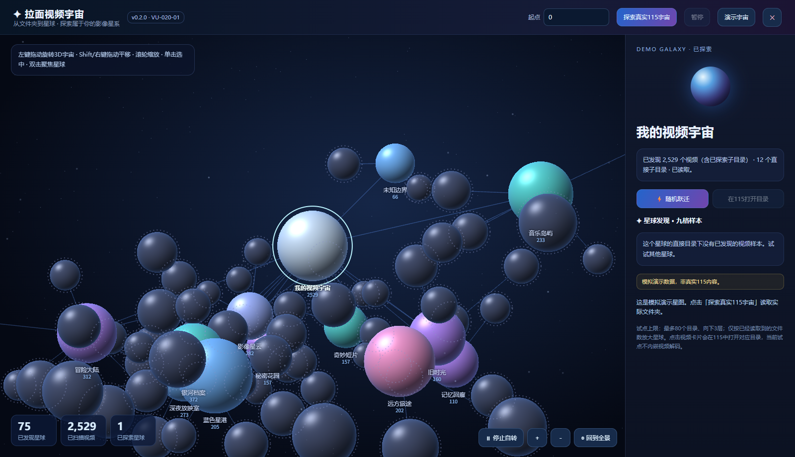

# 拉面视频宇宙 v0.2.0 — 3D 立体星图试点

交付编号：`VU-020-01`；脚本 ID：`115-video-universe`；当前状态：**已批准作为独立公开测试版发布，真实115账号验收后置**。

## 本次做了什么

- 从 2D X/Y 平面目录树改为确定性的 3D X/Y/Z 星球布局。根目录为中心，子目录沿三维螺旋分布，保持父子连线。
- 自带 WebGL GPU 球体片元光照、深度测试和连接线；不支持 WebGL 时保持同一 3D 透视交互，用 Canvas2D 兼容渲染。
- 左键拖动绕轨旋转；滚轮或右下角按钮拉近拉远；Shift+拖动/右键拖动平移；单击选中星球，双击或右侧按钮聚焦并平滑镜头飞行。
- 默认缓慢自转，可停止或恢复；随机跃迁自动飞向陌生星球；点击空白处及“回到全景”回到根目录。
- 原 v0.1.0 的演示星图、真实 115 只读目录分页扫描、暂停/继续、部分扫描数量口径与右侧九格视频样本完整保留。

## 操作验证

本机 HOME Chrome 执行（真实浏览器图形引擎，但 115 API 使用模拟数据）：

```powershell
node experiments/video-universe-v0.2.0/run-browser-smoke.js
$env:UNIVERSE_FORCE_FALLBACK='1'; node experiments/video-universe-v0.2.0/run-browser-smoke.js; Remove-Item Env:\UNIVERSE_FORCE_FALLBACK
npm run check
```

测试覆盖 WebGL、无 WebGL 兼容渲染、鼠标旋转停自转、恢复自转、随机跃迁、模拟只读目录解析、星球深度与近远命中优先级、完整仓库旧版回归。

## 版本隔离

- 沿用已有独立脚本 `115-video-universe` 的 @name/@namespace 和同一独立更新通道；不会升级 `115-multiview-indexed` v0.12.4 或 `115-multiview-full-disk` v1.7.0。
- 旧 `history/115-video-universe/0.1.0.user.js` 历史快照保持原样。新版快照是 `history/115-video-universe/0.2.0.user.js`。
- GitHub Pages 沿用**视频宇宙自己的**安装/更新通道；用户安装新版本不触及稳定多宫格播放器和全盘探索播放器。

## 试点边界

当前只读扫描至多 80 个目录、深度 3，九格仅展示文件样本并打开对应 115 文件夹，**尚未内嵌视频解码**。真实登录 115 账号、站点浏览器扩展和大规模扫描尚未实机验收。离线演示星球和真实扫描数据会明确区分。


